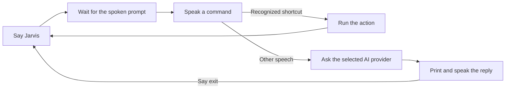

# JARVIS

JARVIS is a Python voice assistant for Windows. Say **“Jarvis”**, wait for **“Listening Sir”**, then ask for the time, open an app, or request a song. The three scripts share the same desktop commands and use different AI providers for open-ended conversation.



## Voice commands

| Say after the prompt | What JARVIS does |
| --- | --- |
| “Current time” or “current date” | Reads the clock or date from your PC. |
| “Weather” | Reads the temperature in Celsius, humidity, and conditions for Dehradun. |
| “Latest news” | Reads up to five US headlines from NewsAPI. |
| “Search for lunar eclipses” | Opens a Google search for “lunar eclipses” in your browser. |
| “YouTube” | Asks what to search for. Say “nothing” to open the YouTube home page. |
| “Notepad” or “Explorer” | Opens the corresponding Windows application. |
| “Music” | Asks for a song, searches Spotify, and requests playback of the first matching track. |

Built-in commands return to the wake word. In AI chat, you can ask follow-up questions directly. Say **“exit”** to return to wake-word listening, or press **Ctrl+C** in the terminal to stop the program.

## Run on Windows

Use Python 3, a microphone, and speakers or headphones. All three scripts use Google Speech Recognition with Indian English (`en-in`), so even the wake word and local desktop commands need an internet connection.

From PowerShell in the repository folder, create a virtual environment and install the shared dependencies.

```powershell
py -m venv .venv
.\.venv\Scripts\python.exe -m pip install "SpeechRecognition[audio]" pyttsx3 requests spotipy
```

Choose one script and install its provider package. For example, these commands select the Google version and start the assistant.

```powershell
.\.venv\Scripts\python.exe -m pip install google-generativeai
.\.venv\Scripts\python.exe JarvisGoogle.py
```

For a first check, say **“Jarvis”**, wait for the prompt, then say **“current time”**. This exercises the microphone, speech recognition, and spoken output independently of the AI provider.

## Providers and credentials

The scripts import settings from [APIKeys.py](APIKeys.py). Replace the placeholders for the services you use in your local copy and keep personal credentials out of commits.

| Script | Provider package | Key in `APIKeys.py` | Chat implementation in this repository |
| --- | --- | --- | --- |
| [JarvisGoogle.py](JarvisGoogle.py) | `google-generativeai` | `googleapikey` | Calls `generate_content` with `gemini-pro`. |
| [JarvisCoHere.py](JarvisCoHere.py) | `cohere` | `cohereapikey` | Calls the legacy Generate endpoint with `command-r-plus`. |
| [JarvisOpenAI.py](JarvisOpenAI.py) | `openai` | `openaiapikey` | Calls the legacy text Completions API with the chat model `gpt-3.5-turbo`. |

The chat integrations use older SDKs, models, or endpoints. For live AI replies, check the selected provider’s supported model and API call. The OpenAI script in particular needs a compatible chat request. [OpenAI model reference](https://developers.openai.com/api/docs/models/gpt-3.5-turbo) · [Cohere deprecations](https://docs.cohere.com/docs/deprecations)

Weather uses `weatherapikey` for OpenWeatherMap, and headlines use `newsapikey` for NewsAPI. For music, set `spclientid` and `spclientsecret` to your Spotify app credentials. Set `SPOTIPY_REDIRECT_URI` in your chosen script to `http://127.0.0.1:8888/callback` and register that exact URI in your Spotify app settings. [Spotify redirect URI requirements](https://developer.spotify.com/documentation/web-api/concepts/redirect_uri)

The Chrome and movie shortcuts use paths specific to the author’s PC. The **“restart”** and **“shut down”** commands act on the Windows machine running JARVIS after a one-second delay.
